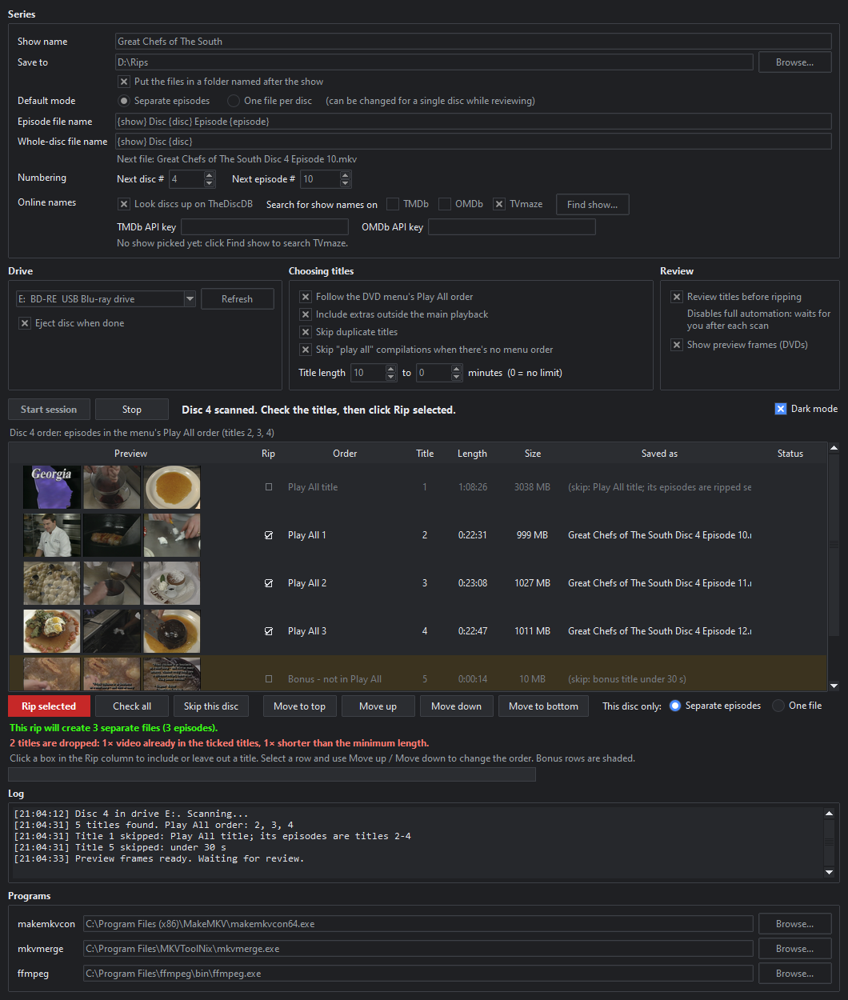
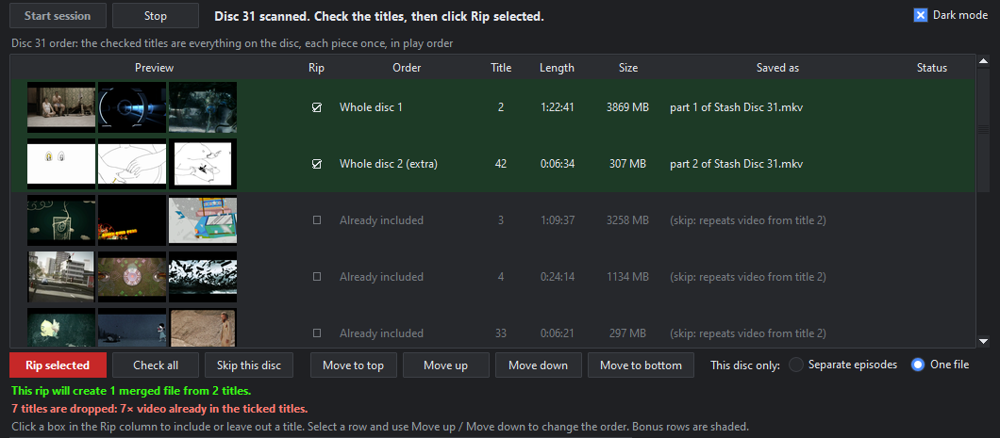

<p align="center"></p>

<h1 align="center">GongoAutoRipper</h1>

A desktop app for Windows, macOS and Linux that drives MakeMKV to rip a whole series of DVDs or Blu-rays: insert a disc, it scans, picks the right titles in Play All order, names them, rips, ejects and waits for the next one.

It's ideal for compilation and collection DVDs with a non-standard structure: short films, anthologies, sketch, music video and commercial collections. On these discs the content is split across dozens of titles, cut up by title cards or repeated between playlists, and plays in the right order only through the disc's menu. GongoAutoRipper reads the menu to recover that order. It can rip the disc as one file that plays like the DVD, with every piece once and the extras at the end.



## Why use it

**Compared with MakeMKV on its own:** MakeMKV rips titles as `title_t00.mkv`, `title_t01.mkv`, and leaves choosing, ordering and renaming to you on every disc. GongoAutoRipper:

- **Merges a whole disc into one MKV** in the order the DVD plays it, with the extras at the end. It works out which titles cover all of the disc's video between them, so nothing plays twice even when the disc repeats segments across its playlists. Each part keeps its chapters, and short audio is padded so title cards don't flash past in the joined file.
- **Follows the DVD menu's Play All order** by stepping through the menu's own button commands. That order is often different from MakeMKV's title order.
- **Numbers episodes across discs** from a filename template: Disc 1 gives Episodes 1-3, Disc 2 continues at 4.
- **Skips Play All compilations, duplicate titles and short clips,** so you get each episode once.
- **Shows preview frames** for each DVD title, so you can see what you are ripping before you start.

**Compared with other ripping tools:**

- [ARM](https://github.com/automatic-ripping-machine/automatic-ripping-machine) is a Linux server with a web interface that runs natively or in Docker. It can identify a disc, but numbering episodes across discs, Play All ordering and merging are left to you.
- [AutoRipper](https://www.autoripper.net/) is a paid desktop app ($10, closed source) that chains MakeMKV, HandBrake and FileBot. It orders TV episodes by title number and online runtimes. It doesn't read the DVD menus or merge discs.
- [DiscSteward](https://github.com/UpsideDownDisk/DiscSteward) is a free Windows app that matches ripped episodes against TheDiscDB or subtitle files and renames them for Plex. It reports complex DVD layouts as unsupported rather than ripping them.

GongoAutoRipper only rips to MKV and doesn't re-encode. If you want smaller files, run the output through HandBrake afterwards.

| | MakeMKV | ARM | AutoRipper | DiscSteward | GongoAutoRipper |
|---|---|---|---|---|---|
| Free and open source | ❌ (free beta) | ✅ | ❌ ($10) | ✅ | ✅ |
| Desktop app on Windows, macOS and Linux | ✅ | ❌ | ✅ | ❌ (Windows) | ✅ |
| Rips the next disc as soon as it's inserted | ❌ | ✅ | ❌ (press Start per disc) | ✅ | ✅ |
| Episode numbering across discs | ❌ | ❌ | ✅ | ✅ | ✅ |
| DVD menu Play All order | ❌ | ❌ | ❌ | ❌ | ✅ |
| One file per disc, no repeated video | ❌ | ❌ | ❌ | ❌ | ✅ |
| Preview before ripping | ❌ | ❌ | ✅ (plays titles) | ❌ | ✅ (frames, DVDs) |
| Online names | ❌ | ✅ OMDb, TMDb | ✅ TheTVDB, TheDiscDB | ✅ TheDiscDB | ✅ TheDiscDB, TMDb, OMDb, TVmaze |
| Re-encodes with HandBrake | ❌ | ✅ | ✅ | ❌ | ❌ |

## Two ways to rip a disc

**Separate episodes.** Each episode becomes its own file, e.g. `Great Chefs of The South Disc 4 Episode 10.mkv`. The Play All title and anything outside the title length range are dropped.

**One file per disc.** The disc becomes one MKV, e.g. `Stash Disc 31.mkv`, in Play All order with bonus features on the end. Titles whose video is already in the ticked titles are dropped, so nothing plays twice. The chapters from each part are kept.



The default mode is set per show, and you can switch it for a single disc while reviewing. Green rows are what gets ripped. The lines under **Rip selected** say how many files the rip will create and why each dropped title was dropped.

## Features

- **Review step (optional):** after each scan you can tick or untick titles, reorder them, or switch the mode for that disc. With review off, the whole run is automatic.
- **Play All detection:** reads the DVD's IFO files and steps through the menus' button commands to find the real playback order. It also finds titles that play before the menu.
- **Online names:** TheDiscDB identifies the exact disc by a hash of its files and labels each title. TMDb, OMDb and TVmaze supply show, season and episode titles. **Find show** searches every source you have ticked and shows how your files would be named before you pick one.
- **Faster multi-title rips:** rips all the needed titles in one MakeMKV pass when that is quicker than one title at a time. The estimate assumes a slow disc.
- **Clean joins:** before merging, short audio tracks are padded to the video length so title cards don't flash past in the joined file.
- **Preview frames:** a start, middle and end frame for each DVD title. Most commercial DVDs are copy-protected (CSS). Previews of those need libdvdcss, a free library from VideoLAN. It isn't included. The first time previews are switched on, the app offers to download and install it with one click on Windows, or shows the install command on macOS and Linux. Ripping never needs it.
- **Retry:** failed titles can be retried after cleaning the disc. Their episode numbers stay reserved.
- **Rip indicator:** while a disc is ripping, the app icon plays the flame animation: in the taskbar on Windows, the Dock on macOS, and the window icon on Linux (X11; most Wayland desktops keep the still icon).
- Dark and light themes, and tooltips on every setting.

## Naming templates

Placeholders: `{show}` `{disc}` `{episode}` `{title}` `{year}` `{season}` `{season_episode}` `{episode_title}`. Python format specs work, e.g. `{episode:02}`.

| Template | Result |
|---|---|
| `{show} Disc {disc} Episode {episode}` | `Great Chefs Disc 2 Episode 5.mkv` |
| `{show} - S{season:02}E{season_episode:02} - {episode_title}` | `Battlestar Galactica - S01E03 - Bastille Day.mkv` |
| `{show} Disc {disc}` (one file per disc) | `Stash Disc 31.mkv` |

`{title}`, `{year}`, `{season}`, `{season_episode}` and `{episode_title}` need an online match. Without one they are left out and any separators around them are cleaned up.

## Download

Ready-to-run builds are on the [Releases](../../releases) page. You don't need Python. Windows and macOS come in two packages:

- **Full** includes the other programs GongoAutoRipper uses, so it works straight away.
- **Lite** leaves them out. Use it if you already have ffmpeg and MKVToolNix: GongoAutoRipper finds them in their usual install locations, or you can set their locations under **Programs**.

| System | Full | Lite |
|---|---|---|
| Windows 10/11 (64-bit) | `GongoAutoRipper-<version>-windows-x64-full.zip` (about 170 MB): ffmpeg, MKVToolNix | `GongoAutoRipper-<version>-windows-x64-lite.zip` (about 75 MB) |
| macOS, Apple Silicon | `GongoAutoRipper-<version>-macos-arm64-full.zip`: ffmpeg | `GongoAutoRipper-<version>-macos-arm64-lite.zip` |
| macOS, Intel | `GongoAutoRipper-<version>-macos-x64-full.zip`: ffmpeg | `GongoAutoRipper-<version>-macos-x64-lite.zip` |
| Linux (64-bit) | `GongoAutoRipper-<version>-linux-x64.tar.gz`, one package; ffmpeg and MKVToolNix come from your distribution | |

Every package needs [MakeMKV](https://www.makemkv.com/) installed separately. You also need:

- **Windows lite:** [MKVToolNix](https://mkvtoolnix.download/downloads.html#windows) and [ffmpeg](https://ffmpeg.org/download.html#build-windows).
- **macOS:** [MKVToolNix](https://mkvtoolnix.download/downloads.html#macosx). Install the app into Applications, or run `brew install mkvtoolnix`. With lite, also `brew install ffmpeg`.
- **Linux:** MKVToolNix and ffmpeg from your distribution, e.g. `sudo apt install mkvtoolnix ffmpeg`.

Preview frames of CSS-protected DVDs also need libdvdcss:

- **Windows:** the app offers to download it from VideoLAN the first time previews are on. To do it by hand instead, put `libdvdcss-2.dll` (64-bit) from [VideoLAN](https://download.videolan.org/pub/libdvdcss/1.2.12/win64/) next to `GongoAutoRipper.exe`.
- **macOS:** `brew install libdvdcss`
- **Linux:** `sudo apt install libdvd-pkg && sudo dpkg-reconfigure libdvd-pkg` on Debian and Ubuntu, `sudo dnf install libdvdcss` (RPM Fusion) on Fedora, or `sudo pacman -S libdvdcss` on Arch.

Unzip and run `GongoAutoRipper`. The builds aren't signed:

- **Windows:** SmartScreen may warn you the first time. Click **More info**, then **Run anyway**.
- **macOS:** right-click the app and choose **Open** the first time. If macOS says the app is damaged, run `xattr -dr com.apple.quarantine GongoAutoRipper.app`.

macOS and Linux support is new and hasn't been tested with a real drive yet.

## MakeMKV and LibreDrive

GongoAutoRipper doesn't read discs itself. MakeMKV does the reading and decryption, and GongoAutoRipper runs its command-line tool, `makemkvcon`. MakeMKV is free while in beta: enter the current [beta key](https://forum.makemkv.com/forum/viewtopic.php?t=1053) in MakeMKV, or buy a licence. When the beta key expires, MakeMKV stops working until you update it or enter the new key. GongoAutoRipper shows MakeMKV's message when that happens.

**LibreDrive is recommended.** LibreDrive is a drive mode in which MakeMKV reads the disc directly, without the restrictions the drive's firmware normally applies. A drive in LibreDrive mode never refuses to read a disc and never reports itself as revoked. UHD Blu-rays need LibreDrive. DVDs and standard Blu-rays don't, but LibreDrive avoids reads failing on discs the stock firmware won't handle.

Many LG, ASUS and Pioneer drives support LibreDrive. Some work as shipped and some need a firmware flash, which MakeMKV's own tools can do. The [LibreDrive forum](https://forum.makemkv.com/forum/viewforum.php?f=19) lists drives and firmware. To check your drive, look for "Using LibreDrive mode" in GongoAutoRipper's log after a disc is scanned, or for **LibreDrive Information** in MakeMKV's drive info.

## Requirements (running from source)

- Windows 10 or 11, macOS, or Linux
- Python 3.10 or newer with Tk (on Debian and Ubuntu, `sudo apt install python3-tk`), plus `pip install -r requirements.txt` (Pillow, OpenCV)
- [MakeMKV](https://www.makemkv.com/) with a valid key or the current beta key
- [MKVToolNix](https://mkvtoolnix.download/)
- [ffmpeg](https://ffmpeg.org/download.html)
- libdvdcss (optional, for preview frames of CSS-protected DVDs). Install it as described under [Download](#download). When running from source on Windows, you can also put `libdvdcss-2.dll` in `vendor\libdvdcss\`.
- A free API key from [TMDb](https://www.themoviedb.org/settings/api) or [OMDb](https://www.omdbapi.com/apikey.aspx) (optional, for TMDb or OMDb lookups; TheDiscDB and TVmaze need no key)

GongoAutoRipper looks for MakeMKV, mkvmerge and ffmpeg in their default install locations, Homebrew and `PATH`. You can also set their locations under **Programs**.

On Linux, your user needs access to the drive. That usually means being in the `cdrom` group (`optical` on Arch). MakeMKV also needs the `sg` kernel module loaded (`sudo modprobe sg`).

## Run

```
pythonw gongoautoripper.py
```

Use `python3` instead of `pythonw` on macOS and Linux. On Windows, to launch it like a normal app, make a shortcut to `pythonw.exe` with the script path as its argument, and use `assets\icon.ico` as the icon.

Settings, the log, preview frames and a downloaded libdvdcss are stored in `%APPDATA%\GongoAutoRipper` on Windows, `~/Library/Application Support/GongoAutoRipper` on macOS, and `~/.config/GongoAutoRipper` on Linux. API keys are saved there in plain text.

## Build

```
pip install pyinstaller -r requirements.txt
python build.py --tools --version 1.0.0
```

This builds a standalone app for the system it runs on, in `dist/`. `--tools` first downloads the programs the full package includes (see [Download](#download)), then builds both the lite and full packages.

## Files

| File | Purpose |
|---|---|
| `gongoautoripper.py` | GUI, rip session, title planning, naming, joining |
| `dvdnav.py` | DVD IFO parser and menu emulation for Play All order and whole-disc coverage. `python dvdnav.py E:` (or the disc's mount folder) prints a disc's analysis. |
| `lookup.py` | TheDiscDB, TMDb, OMDb and TVmaze lookups |
| `thumbs.py` | Preview frame grabbing, including libdvdcss for CSS discs and its download on Windows |
| `udf.py` | Reads a DVD's UDF file system to find where each video file starts, for protected-disc previews |
| `platforms.py` | Differences between Windows, macOS and Linux: drives, settings folder, finding the tools |
| `build.py` | Standalone builds with PyInstaller |

## License

[PolyForm Noncommercial 1.0.0](LICENSE): free to use, change and share for any noncommercial purpose. Selling it or other commercial use needs a separate license; open an issue to ask.

Release builds also contain third-party programs under their own licences, listed in [THIRD-PARTY.md](THIRD-PARTY.md).
